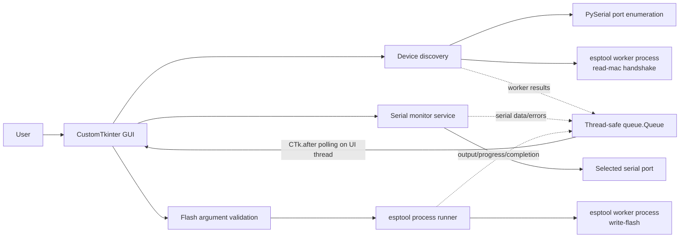

# Espress View

Espress View (`espress_view`) is a desktop **Serial Port Interface Viewer & Firmware Flasher** built with [CustomTkinter](https://github.com/TomSchimansky/CustomTkinter) and [PySerial](https://github.com/pyserial/pyserial). It discovers ESP devices, provides a live serial terminal, and programs firmware through Espressif's `esptool`.

## Features

- **Serial Monitor:** connect to a discovered device, choose a baud rate, view retained serial output, clear or export logs, and send the exact text entered (UTF-8, without an added newline).
- **Firmware Flasher:** program one to five `.bin` images at user-selected hexadecimal addresses, with streamed output, progress reporting, and abort control.
- **Device Discovery:** probe visible serial ports using an `esptool read-mac` handshake; list devices that respond with their chip type, port, and MAC address.
- **Monitor and Flash workspaces:** switch between the serial terminal and firmware layout while sharing device discovery.

The Monitor baud rate defaults to `115200`; the Flash baud rate defaults to `2000000`. The current file picker accepts `.bin` firmware files. Intel HEX (`.hex`) is not currently supported directly.

## Architecture



**Thread boundary:** Tk widgets and Tk variables are only read or changed on the GUI thread. Background workers perform discovery, serial reads, and flash-process management, then publish results through `queue.Queue`. The GUI periodically drains that queue using `CTk.after()`. The serial monitor writes on the GUI thread when the user sends text.

## Quickstart

Python 3.10 or later is required. From the repository root:

### Windows PowerShell

```powershell
py -m venv .venv
.\.venv\Scripts\Activate.ps1
python -m pip install --upgrade pip
python -m pip install -e .
python -m espress_view
```

### macOS or Linux

```sh
python3 -m venv .venv
source .venv/bin/activate
python -m pip install --upgrade pip
python -m pip install -e .
python -m espress_view
```

For executable packaging, install the build-only dependencies with `python -m pip install -r scripts/requirements.txt`, then see [the packaging guide](docs/packaging-guide.md). The shared helper in `scripts/` is generic and configured by command-line options; see [scripts/README.md](scripts/README.md) before reusing it as a submodule.

Run the backend tests with:

```sh
python -m unittest discover -s tests
```

## Serial-port troubleshooting

### Permission denied or access denied

- Close other serial terminals and IDE serial monitors, then retry.
- On Linux, check that your account has permission to access the device (commonly through the `dialout` or `uucp` group); log out and back in after changing group membership.
- Check the operating-system device permissions and USB-to-UART driver. Do not run the application as administrator/root as a routine workaround.

### Port busy or already in use

Only one program can normally own a serial port at a time. Disconnect Espress View's Monitor before flashing, close other terminal/IDE applications using that port, and reconnect or rescan the device. If a previous process exited unexpectedly, make sure it has released the port before trying again.

### Device is not discovered

Discovery requires a powered ESP device able to respond to the ROM bootloader handshake. Check the cable, driver, selected port, power, and boot/reset state, then select **Rescan**. More details are in the [user manual](docs/user-manual.md).

## Documentation

- [Architecture](docs/architecture.md)
- [Bootloader protocols](docs/bootloader-protocols.md)
- [Packaging guide](docs/packaging-guide.md)
- [User manual](docs/user-manual.md)
- [Contributing](CONTRIBUTING.md)
- [Changelog](CHANGELOG.md)
- [License](LICENSE)

## Project layout

```text
espress_view/
├── assets/
│   └── icons/                      # Application and control icons (.ico, .png, .svg)
│
├── docs/                           # Documentation guides
│   ├── architecture.md             # System design, threading, and Mermaid diagrams
│   ├── bootloader-protocols.md     # Flashing sequence and protocol specifications
│   ├── packaging-guide.md          # PyInstaller bundling instructions
│   └── user-manual.md              # End-user operations and troubleshooting
│
├── scripts/                        # Build scripts & automation
│   ├── build_executable.py         # PyInstaller build runner & post-packaging script
│   └── espress_view.spec           # PyInstaller specification file
│
├── src/
│   └── espress_view/
│       ├── __init__.py             # Package version (__version__) and metadata
│       ├── __main__.py             # Module execution entry point (python -m espress_view)
│       │
│       ├── core/                   # Device discovery and serial-monitor I/O
│       │   ├── __init__.py
│       │   ├── discovery.py        # USB/COM port enumeration and auto-detect
│       │   ├── serial_worker.py    # Background PySerial thread reader/writer
│       │   └── logger.py           # Stream logging and raw data capture
│       │
│       ├── flasher/                # Firmware validation and esptool process management
│       │   ├── __init__.py
│       │   ├── esptool_wrapper.py  # esptool execution, argument building, subprocess runner
│       │   ├── validator.py        # Chip detection, partition table, and binary offset checks
│       │   └── progress_parser.py  # Regex/stream parser to extract flashing % into events
│       │
│       ├── gui/                    # CustomTkinter application window
│       │   ├── __init__.py
│       │   ├── app.py              # Root CTk window, main loop, queue event listener (.after())
│       │   ├── frames/             # Major layout panes (CTkFrame)
│       │   │   ├── __init__.py
│       │   │   ├── connection_pane.py  # COM port & baud rate selection
│       │   │   ├── monitor_pane.py     # Serial terminal output view
│       │   │   └── flasher_pane.py     # Binary selector, chip settings, flash progress
│       │   └── widgets/            # Reusable UI controls
│       │       ├── __init__.py
│       │       └── port_combobox.py
│       │
│       └── utils/                  # Resource paths and single-instance guard
│           ├── __init__.py
│           ├── single_instance.py  # Lockfile / socket guard against multiple app instances
│           ├── paths.py            # Resolves asset paths across dev & frozen PyInstaller bundles
│           └── config.py           # User preferences persistence (theme, last baud rate)
│
├── tests/                          # Backend unit & integration tests
│   ├── __init__.py
│   ├── test_discovery.py           # Port detection tests
│   ├── test_esptool_wrapper.py     # Mock subprocess and progress parsing tests
│   └── test_serial_worker.py       # Serial mock loop tests
│
├── .gitignore
├── CHANGELOG.md                    # Release history
├── CONTRIBUTING.md                 # Development & PR guidelines
├── LICENSE                         # License terms (e.g., MIT, Apache 2.0)
├── README.md                       # Main repo landing page and overview
├── pyproject.toml                  # Modern build definitions & package dependencies
└── requirements.txt                # Locked dependencies (customtkinter, pyserial, esptool)
```
