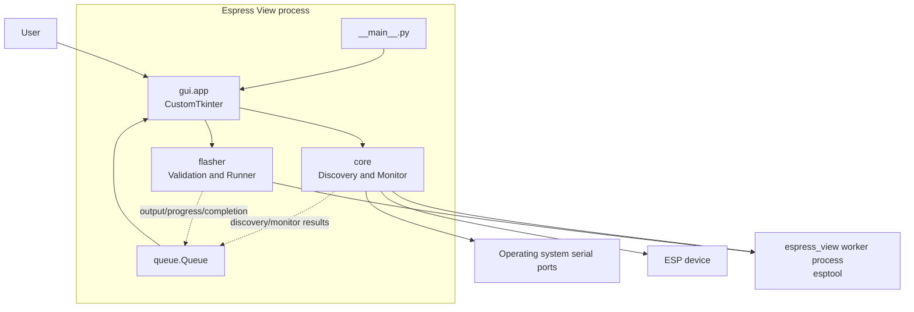
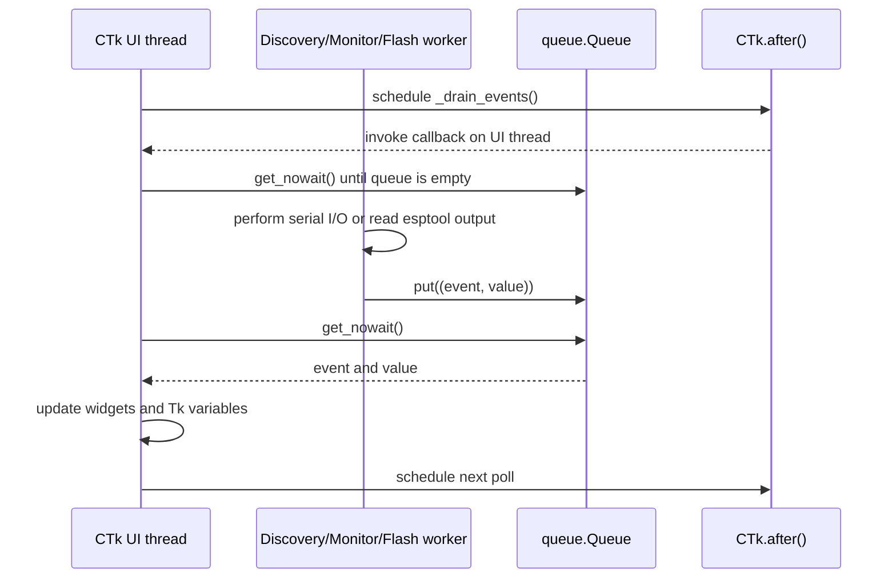

# Architecture

Espress View is a local desktop application. The CustomTkinter frontend coordinates UI state and delegates device access and firmware flashing to backend modules. It does not run a network server.

## Layers

| Layer | Responsibility | Boundary |
|---|---|---|
| `gui` | Main window, discovery selector, Monitor and Flash workspaces, progress/log rendering, user interactions, shared design tokens, and bundled Lucide icons | Owns all Tk/CustomTkinter widgets and variables |
| `core` | Enumerate serial ports, handshake candidate ESP devices, open/read/write/close the serial monitor | No Tkinter or CustomTkinter imports |
| `flasher` | Validate addresses and binaries, build esptool arguments, run/abort the esptool child process, stream output | No Tkinter or CustomTkinter imports |
| `utils` | Resolve the application icon in source/PyInstaller execution; persist appearance, baud-rate, view, and window-size preferences; guard against duplicate Windows launches | Platform, settings, and resource helpers |
| `assets/icons` | Application and control images | Shared runtime resources |

The package entry point is `espress_view.__main__`. In a source checkout, use `python -m espress_view`; PyInstaller packages the same entry point for executable distribution.

## Thread and queue boundary

The GUI starts device discovery and serial reading on background threads so serial waits do not block the window. The flash thread manages a child worker process and forwards its start, merged output, parsed percentage, and completion events. The Abort control is enabled only after the child process starts. These workers publish `(event, value)` pairs into a thread-safe `queue.Queue`; they must not call Tk methods or mutate Tk variables. Progress stays indeterminate until esptool emits a percentage, and completion does not invent a final percentage.

The UI schedules `_drain_events` with `after`, drains up to 500 queued events on the Tk thread, batches terminal output, updates widgets, then schedules the next poll. Monitor writes are issued in response to UI actions; monitor disconnect closes the active serial handle and sets that connection's stop event.

The GUI keeps the user's current window geometry when switching workspaces or expanding flash output. Its shared `gui.design` tokens provide light/dark semantic colors; `gui.icons` loads locally bundled Lucide PNGs and tints them with Pillow, so runtime use requires neither network access nor a separate icon dependency. Appearance preference is persisted as Light, System, or Dark; CustomTkinter resolves System using the operating system's current preference.

## Discovery flow

At startup and on Rescan, the GUI starts a scan worker. `core.device_discovery` enumerates ports through PySerial, invokes the bundled esptool worker with `read-mac` per candidate (six-second timeout), and returns devices that produced a MAC address. The GUI displays `Chip Type | COM ID | MAC Address`.

## Flash flow

The GUI passes selected port, baud rate, and firmware rows to `flasher.arguments`. After local validation, a background thread calls `flasher.runner.FlashRunner`, which starts the worker process with combined stdout/stderr. Output and completion events go to the UI queue; percentage text is parsed from esptool output. Abort requests termination of the active child process.

The application does not implement ESP bootloader framing or erase/write/verify commands itself; the bundled esptool performs those chip-specific operations.
