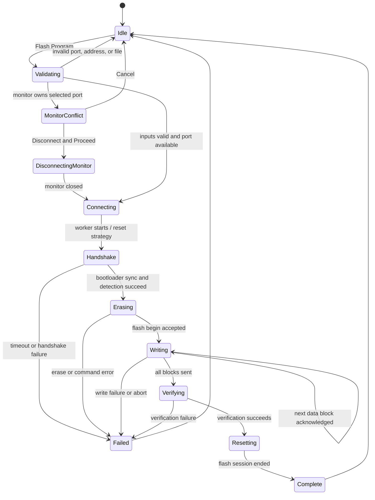
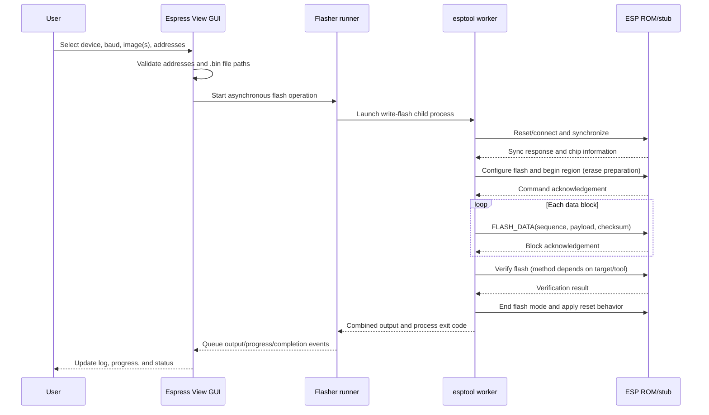

# Bootloader Protocols

## Scope and accuracy

Espress View delegates bootloader communication to `esptool`. Its own serial-monitor path transports arbitrary user text; it does not construct firmware protocol packets. The sequence below documents the typical Espressif ROM serial bootloader lifecycle at a conceptual level. Exact commands, reset behavior, packet details, erase strategy, and verification vary by chip, ROM/stub, and esptool version.

## UART packet framing

The requested generic packet vocabulary can be summarized as:

| Field | Purpose |
|---|---|
| Start/end framing | Delimits a packet on the byte stream; ESP ROM serial protocol uses SLIP framing |
| Header | Identifies packet direction and command/response |
| Length | Declares the command payload length |
| Command | Operation code, such as SYNC, FLASH_BEGIN, or FLASH_DATA |
| Payload | Operation parameters and, for data blocks, firmware bytes |
| Integrity value | Checks data integrity; exact form depends on packet and chip |

In the generic frame vocabulary this can be written as:

```text
SLIP_START | HEADER | LENGTH | COMMAND | PAYLOAD | CRC_OR_CHECKSUM | SLIP_END
```

**Important distinction:** this table is a generic header/length/command/payload/integrity description, not a claim that the ROM protocol uses a universal CRC field. In the esptool serial ROM packet format, a request begins with direction, opcode, little-endian payload length, and a 32-bit checksum field, followed by data; a response has a corresponding header and response data. SLIP `END` delimiters (`0xC0`) frame packets, and reserved SLIP bytes are escaped. The ROM checksum used for flash data is an XOR checksum, not a CRC. Flash verification can use chip/esptool-supported mechanisms such as flash MD5. Consult esptool and the target chip's official documentation for wire-level details.

The fields are little-endian where defined by the ROM packet format. Do not implement packet parsing by assuming the generic table alone is a wire specification.

## Flash lifecycle

Conceptually, esptool resets or connects to the device in download mode, synchronizes with the bootloader, identifies/configures the target, starts a flash download (which includes erase preparation), sends sequenced blocks, checks the result, and ends flash mode with the requested reset behavior. esptool may use a RAM stub and chip-specific commands. Espress View presents the worker output and progress; it does not independently issue each protocol state.





## State/error handling

- A serial port already in use, wrong boot mode, wiring/power issue, reset failure, unsupported target command, timeout, or invalid image can stop the lifecycle.
- The GUI will not flash while Monitor is connected. For the same selected port it offers Disconnect and Proceed or Cancel.
- Abort terminates the esptool worker process; the operation can stop at any point, so the image may be incomplete and the device may need a full reflash.
- Use esptool's reported exit status and output as the source of truth. The GUI's percentage display parses percentage text and is not an independent verification result.
